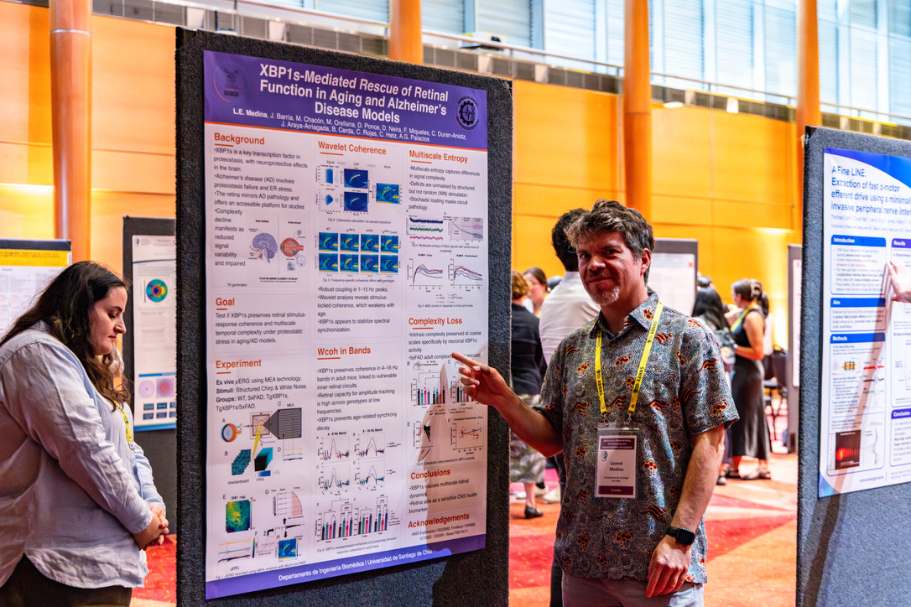
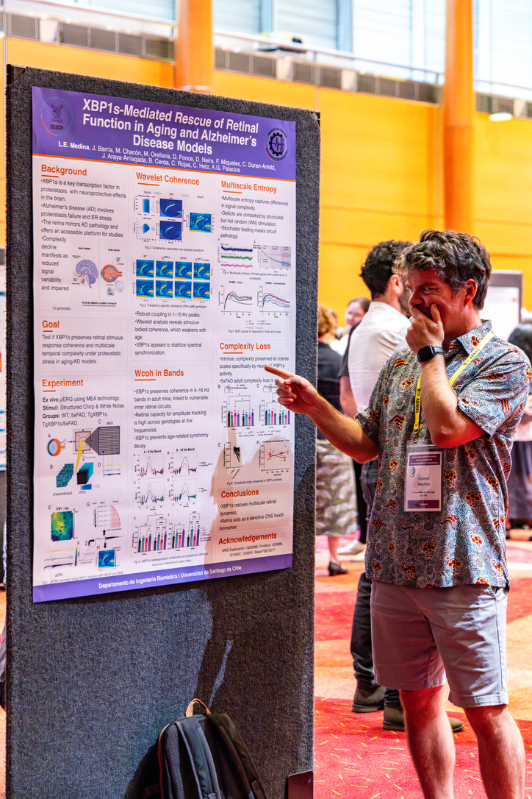

**Purpose**
Aging and neurodegeneration disrupt neural complexity and coordination across central and peripheral circuits,
contributing to functional decline in Alzheimer’s disease (AD). Although the unfolded protein response transcription factor X-box binding protein 1 spliced form (XBP1s) preserves proteostasis and synaptic function in the AD brain, its impact on retinal function remains unknown. Here, we evaluated whether XBP1s overexpression preserves retinal electrophysiology in aging and AD mouse models. Our work was motivated by a recent theory of complexity loss with age and disease, and we aimed to quantify electrophysiological complexity at different ages.
**Methods**
Retinal activity was recorded ex vivo using micro-electroretinography (µERG) during structured chirp and white-noise stimuli in wild-type (WT), XBP1s-overexpressing (TgXBP1s), AD mouse model (5xFAD), and crossbred of TgXBP1s and 5xFAD (TgXBP1s/5xFAD) mice at 3 and 7 months. We quantified the irregularity of µERG signals by means of the fuzzy entropy and applied the Refined Composite Multiscale Entropy (RCMSE) method, which calculates the entropy over coarse-grained versions of the original signal using a refined averaging strategy, to obtain complexity indices as the normalized area under the RCMSE curve. As well, we calculated the wavelet coherence (Wcoh) between the chirp stimulus and the corresponding µERG response defined as the time-frequency representation of the normalized cross-wavelet transform of these two signals.
**Results**
Entropy-based metrics and wavelet coherence analyses revealed age- and stimulus-dependent declines in retinal complexity and stimulus–response coupling in WT and 5xFAD mice, whereas TgXBP1s and TgXBP1s/5xFAD mice maintained higher complexity and coherence. Genotype-dependent effects were most prominent at higher temporal scales, reflecting preservation of integrative retinal dynamics.
**Conclusions**
These findings establish the first direct evidence that sustained XBP1s expression restores retinal function during aging and AD pathology, positioning XBP1 as a pioneering therapeutic target and the retina as an accessible system to evaluate neuroprotective interventions.

