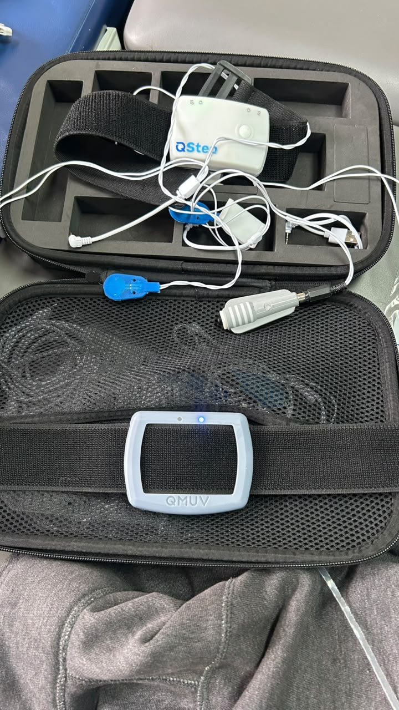
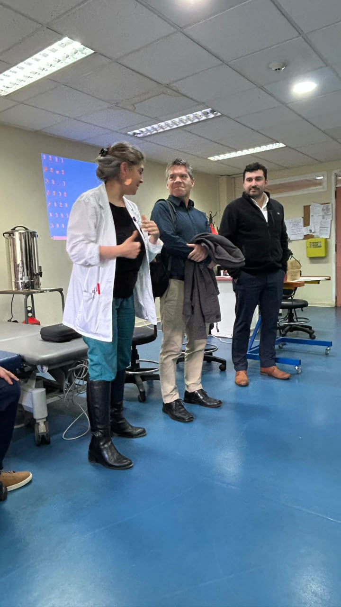
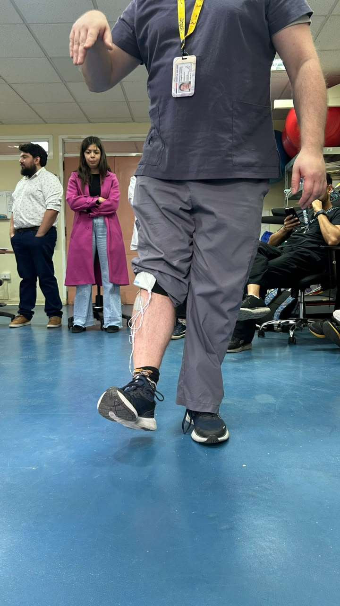

El pasado 22 de octubre de 2026, la **Unidad de Medicina Física y Rehabilitación (UMFR) del Complejo Hospitalario San José (CHSJ)** y la **Universidad de Santiago de Chile (USACH)** llevaron a cabo una jornada de trabajo colaborativo que marca el inicio de una alianza estratégica para transferir innovación tecnológica e investigación aplicada al sistema público de salud.

La actividad fue coordinada por la **Dra. Constanza Ovalle**, médica fisiatra y coordinadora del Programa de Neurorrehabilitación de la UMFR-CHSJ. La contraparte académica de la USACH estuvo integrada por los profesores de la carrera de Ingeniería Civil Biomédica e investigadores **[Leonel Medina](/authors/leomedina)** y **[Rodrigo Osorio](/authors/rodrigoosorio)**, junto a la estudiante tesista **Naiara Abarzúa**, acompañados por el académico e ingeniero biomédico **Francisco Saavedra**, de la Universidad de Concepción.

---

### Dos Tecnologías al Servicio de la Rehabilitación

Durante el encuentro se presentaron y probaron en vivo dos dispositivos de vanguardia desarrollados por el área de ingeniería biomédica:

1. **Q-Step:** Dispositivo de neurorrehabilitación diseñado por el académico **Francisco Saavedra (UdeC)**, orientado a la asistencia y recuperación funcional de personas con secuelas neurológicas, como el accidente cerebrovascular (ACV) y el pie caído (*drop foot*).
2. **QMUV:** Sistema portátil para la evaluación cuantitativa de la marcha que, mediante sensores inerciales y una aplicación móvil dedicada, permite registrar y objetivar parámetros funcionales biomecánicos en tiempo real.

*Dispositivos de neurorrehabilitación Q-Step y de evaluación funcional de marcha QMUV.*

Los equipos clínicos de la UMFR pudieron interactuar de primera mano con los dispositivos, revisar las mediciones funcionales obtenidas y dialogar con los ingenieros respecto a los requerimientos prácticos para su incorporación en la rutina de atención hospitalaria.

*La Dra. Constanza Ovalle dialoga con Leonel Medina (USACH) y Francisco Saavedra (UdeC, diseñador de Q-Step) durante la sesión técnica.*

---

### De la Investigación a la Salud Pública: Trabajo con la Comunidad y Docencia

Uno de los ejes centrales de la jornada fue asegurar que la innovación biomédica y la investigación trasciendan el ámbito de laboratorio y se traduzcan en soluciones concretas para los pacientes que se atienden en el sistema público de salud.

*Al fondo, el profesor Rodrigo Osorio y la tesista de Ingeniería Civil Biomédica USACH Naiara Abarzúa observan la prueba funcional de marcha con el dispositivo Q-Step.*

En este marco, se definieron áreas de trabajo conjunto clave:

* **Memorias de título con impacto clínico real:** Los profesores Leonel Medina y Rodrigo Osorio guiarán a la tesista de Ingeniería Civil Biomédica de la USACH, **Naiara Abarzúa**, en el desarrollo de su trabajo de titulación enfocado en las necesidades clínicas de la unidad.
* **Evaluación biomecánica en personas amputadas:** Aplicar el sistema portátil QMUV para objetivar los parámetros de marcha y evolución funcional de pacientes que reciben prótesis en el CHSJ, centro de referencia a nivel nacional en esta área.
* **Neurorrehabilitación personalizada:** Protocolos de seguimiento y asistencia tecnológica en personas con ACV y pie caído.
* **Búsqueda de financiamiento conjunto:** Postulación a fondos públicos y de investigación para modernizar y ampliar el equipamiento tecnológico disponible para los usuarios del hospital.

---

### Fortalecimiento de lazos institucionales

En la sesión participaron activamente médicos fisiatras, kinesiólogos/as y terapeutas ocupacionales del **Equipo de Neurorrehabilitación**, así como profesionales del **Programa de Amputados** de la UMFR.

Ambas instituciones continuarán coordinando mesas de trabajo para consolidar convenios asistenciales-docentes de largo plazo, fortaleciendo el vínculo virtuoso entre la universidad pública, la formación de nuevos profesionales de la ingeniería biomédica y la salud de la comunidad.
