+++
title = "NeuroEng@Usach presente en NeuroFest 2024"
date = 2024-09-28T09:00:00-03:00
date_end = 2024-09-28T18:00:00-03:00
draft = false

# Tags and categories
# For example, use `tags = []` for no tags, or the form `tags = ["A Tag", "Another Tag"]` for one or more tags.
tags = ["ANID Exploracion", "Neuroscience", "NeuroFest"]
categories = []
projects = []

# Featured image
# To use, add an image named `featured.jpg/png` to your page's folder. 
  # Caption (optional)
  caption = "Neurofest 2024"

  # Focal point (optional)
  # Options: Smart, Center, TopLeft, Top, TopRight, Left, Right, BottomLeft, Bottom, BottomRight
  focal_point = "Smart"

+++
¡NeuroEng@Usach se hizo presente en [NeuroFest](https://www.neurofest.cl)! Nuestro grupo de neuroingeniería de la carrera de [Ingeniería Civil Biomédica Usach](https://ingenieriabiomedica.usach.cl) participó en NeuroFest con un stand llamado "Neurotecnologías". 

NeuroFest es una feria de neurociencia abierta a la comunidad que en esta primera edición convocó a varios miles de personas en la Plataforma Cultural Juan Goméz Millas de la Universidad de Chile. NeuroFest se llevó a cabo en dos jornadas: el viernes 27 de septiembre recibió a escolares de 4to básico a 4to medio, miestras que el sábado 28 estuvo abierta al público general. NeuroFest fue una verdadera fiesta del cerebro, donde no sólo se promovió la alfabetización neurocientífica de la comunidad, sino que también se generó una instancia para que la neurociencia puediera ser disfrutada por todos y todas. 

En el stand de Neurotecnologías mostramos demostraciones de aplicaciones neuroingenieriles, y presentamos pósters para ilustrar algunos de nuestros trabajos de investigación, con énfasis en el uso de herramientas de complejidad para el análisis de señales bioeléctricas. Las demostraciones y pósters fueron desarrolladas por estudiantes de Ingeniería Biomédica de la Usach.

**Sebastián Chávez** implementó una [aplicación web](https://github.com/Seba3995/EEG_web_app) para la adquisición y análisis de señales de electroencefalografía (EEG), que muestra el contenido espectral de un registro EEG y su nivel de entropía. Con algunos participantes realizó un experimento para mostrar las diferencias de entropía del EEG al escuchar distintos tipos de música: clásica versus metal.

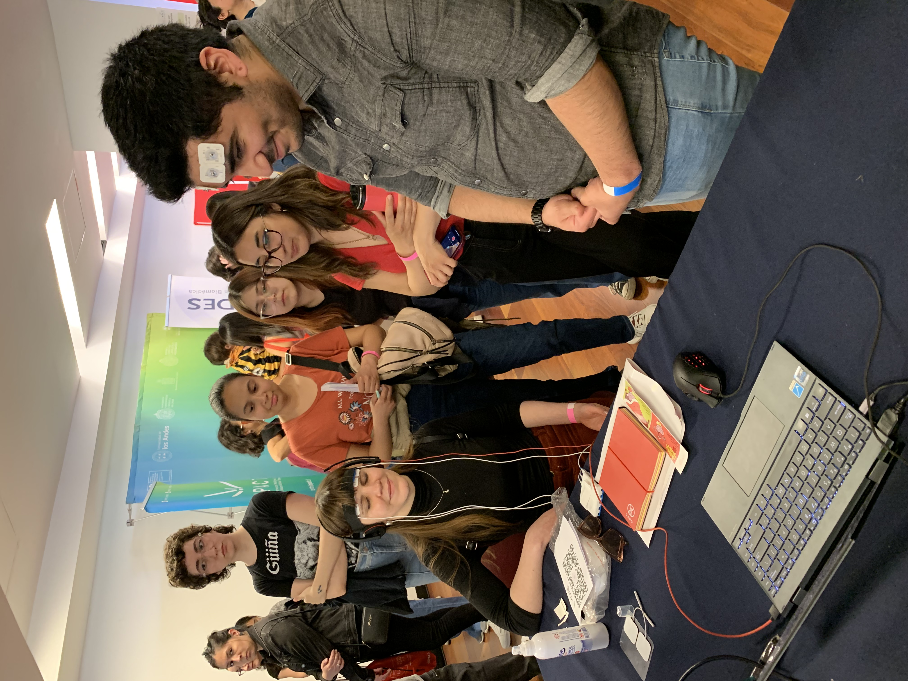

Por su parte, **Juan Pablo Sepúlveda** implementó un prototipo de dispositivo para medir el bloqueo neuromuscular, basado en un estimulador TENS y un sensor de movimiento conectado a un microprocesador Arduino. El dispositivo aplica corrientes para generar contracciones musculares que son detectadas con un acelerómetro. Durante NeuroFest, muchas personas probaron la demostración en que se midió el nivel de contracciones musculares al aplicar pequeños pulsos de corriente.

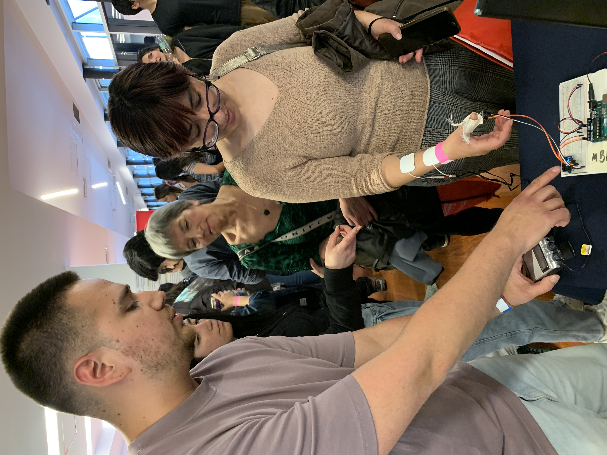

**Joaquín Aguilera**, en tanto, preparó una demostración de la mano robótica en la que ha estado trabajando durante su investigación bajo la supervisión del profesor Britam Gómez. En NeuroFest, Joaquín demostró como controlar la mano robótica mediante un conjunto de botones para generar movimientos coordinados y realistas, similares a una mano real.

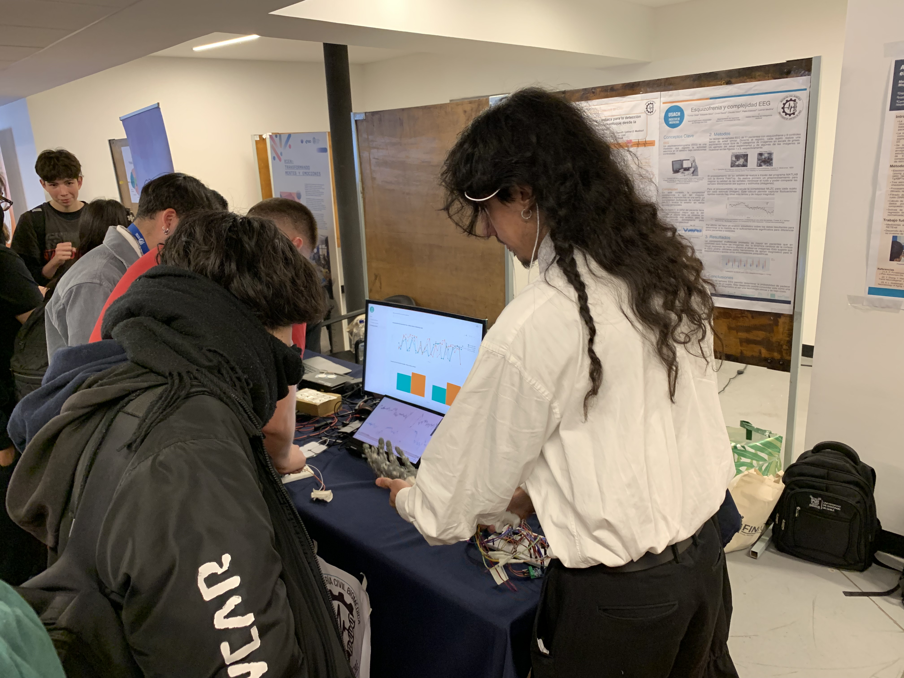

[**Constanza Aravena**]() mostró el dispositivo RETeval para medición no invasiva del ERG y que estamos utilizando para nuestra investigación de [detección de enfermedades neurodegenerativa a través del ojo](). Durante NeuroFest, Constanza realizó mediciones de ERG utilizando RETeval a algunas personas voluntarias.

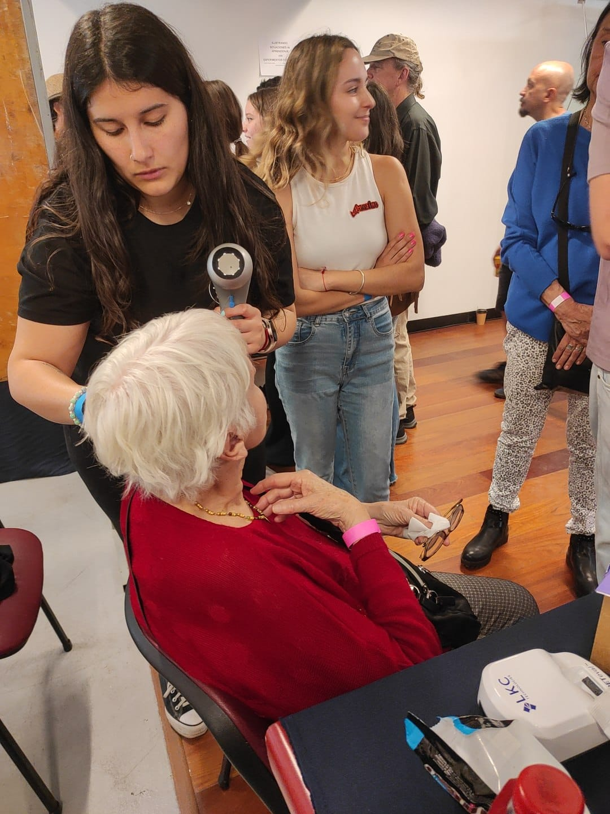
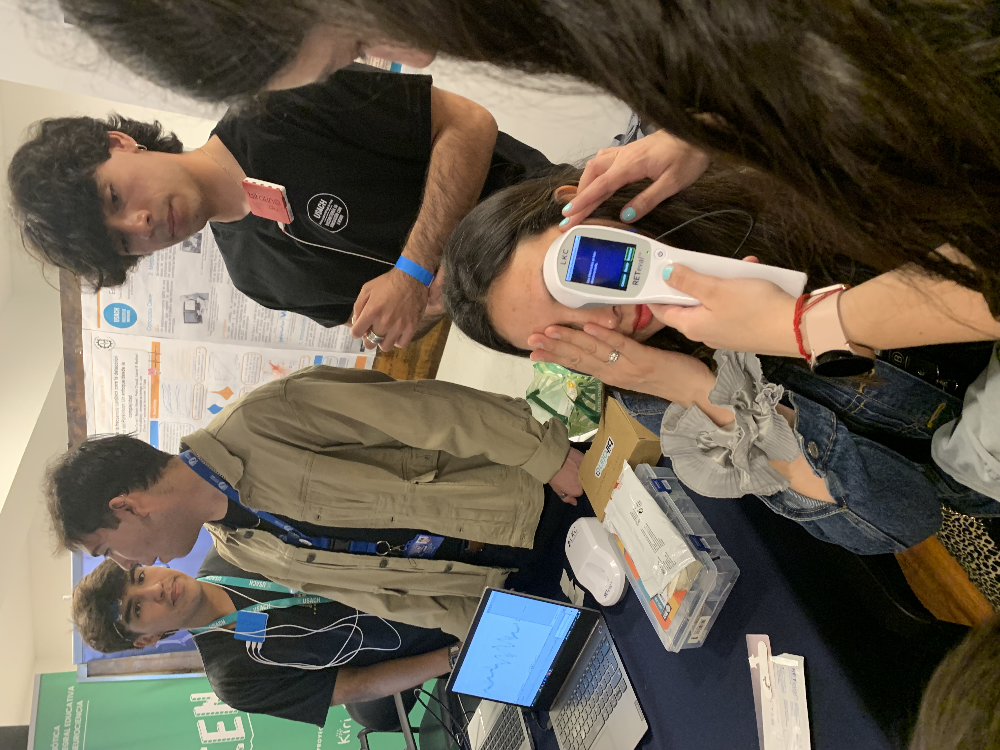

Una cuarta demostración estuvo a cargo de [**Eduardo Berríos**]() y [**Tiara Torres**](), quienes utilizaron el dispositivo HeartBit de Bitalino para mostrar electrocardiografía (ECG) en vivo. Esta señal la estamos utilizando para determinar las diferencias en la tasa de latido cardiaco de personas con la enfermedad de Parkinson respecto de personas sanas.

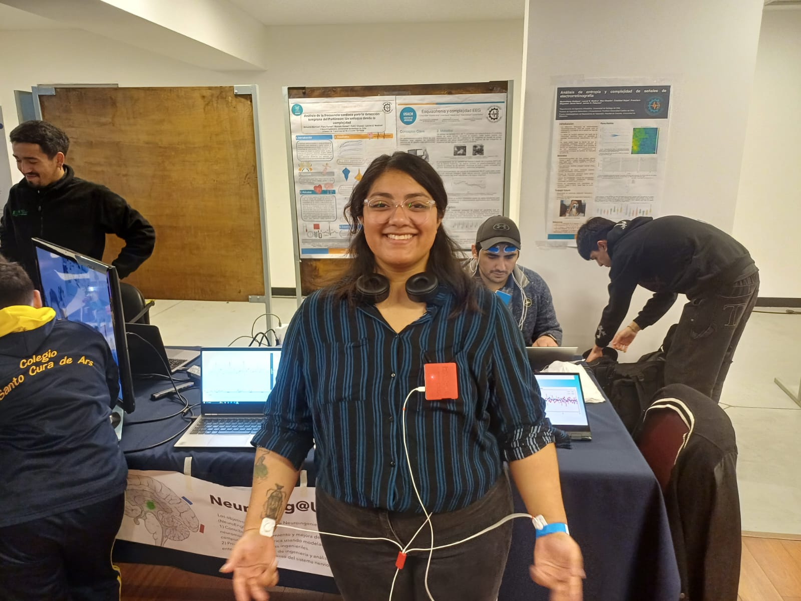
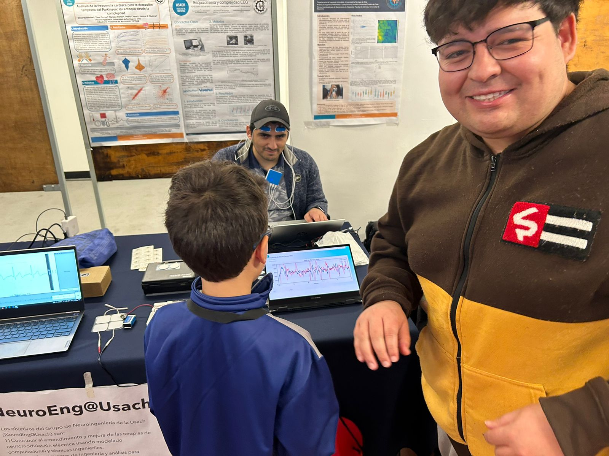

Finalmente, **Tomás Olate**, **Eduardo Berríos** y **Maximiliano Orellana** prepararon pósters para mostrar nuestros trabajos de análisis de complejidad de EEG, ECG y ERG, aplicados a la detección de esquizofrenia, enfermedad de Parkinson y enfermedad de Alzheimer, respectivamente. Durante NeuroFest, muchos visitantes mostraron gran interés por aprender un poco acerca de las herramientas ingenieriles que estamos utilizando para la detección de estas patologías en estrecha colaboración con profesionales e investigadores del área de la salud.

Al equipo de [NeuroEng@Usach]() en NeuroFest también se sumaron **Alelí Galaz**, **Cristián Dávila**, **Felipe Díaz**, **Lukas Opazo**, **Josué Hernandez** e **Isidora Lara**, estudiantes de diversos niveles de Ingeniería Civil Biomédica de la Usach, quienes apoyaron en las demostraciones y, junto con todo el equipo, respondieron preguntas de neurotecnologías y de las investigaciones que estamos realizando.

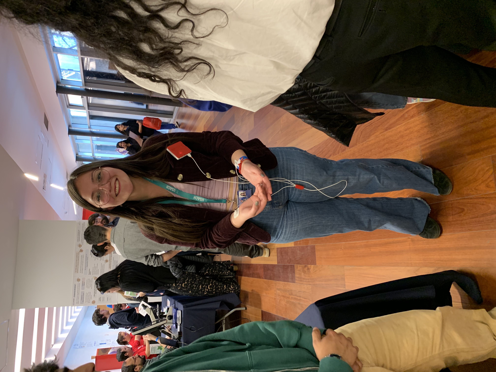

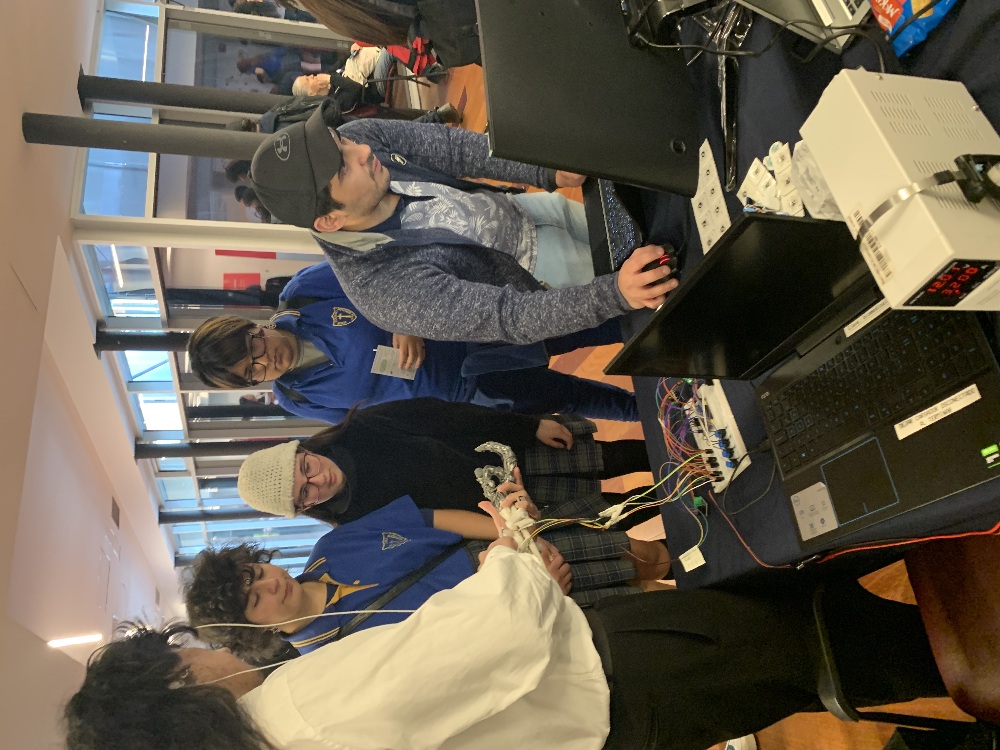

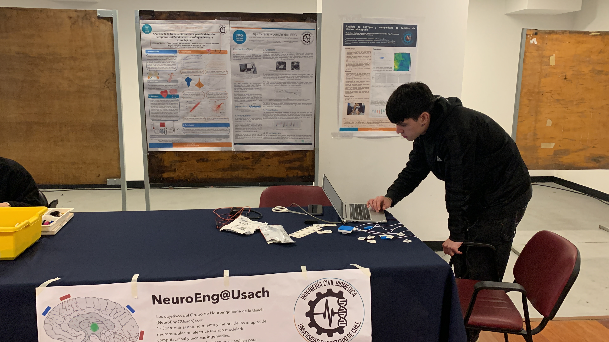

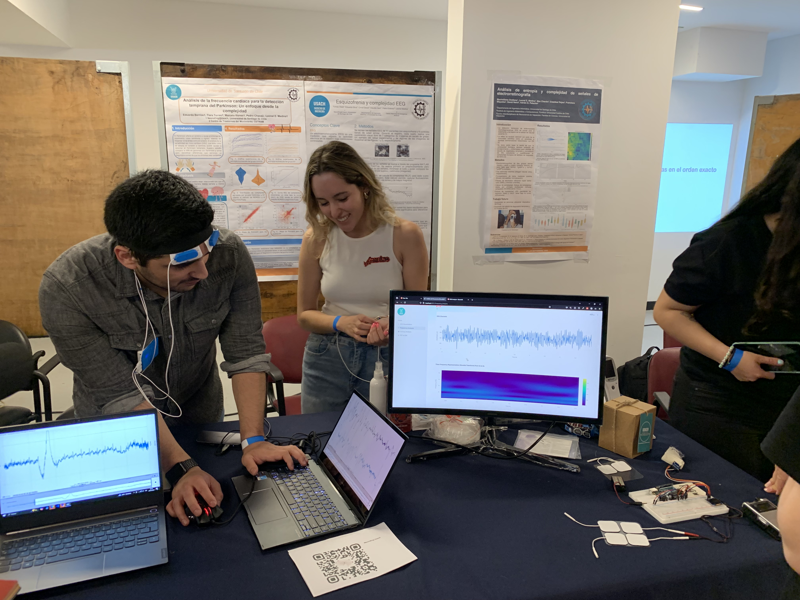

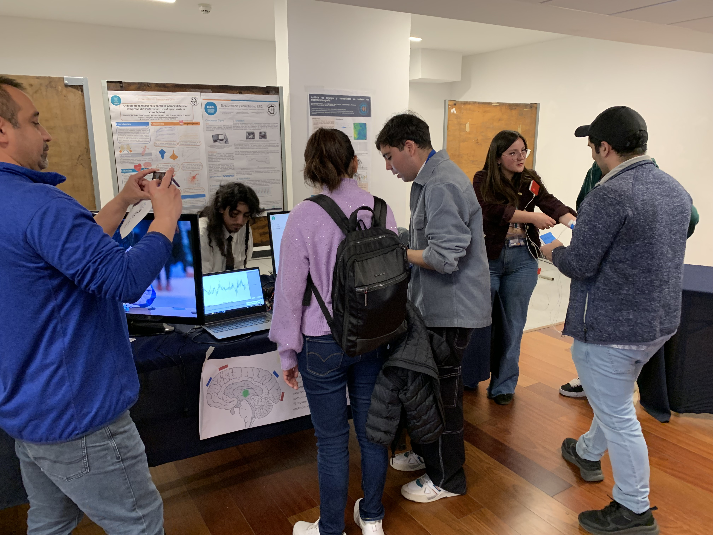

En suma, ¡un éxito NeuroFest y nuestro stand de Neurotecnologías!
