For a researcher, a sabbatical is a precious opportunity to step out of the daily routine, dive headfirst into new challenges, and forge collaborations that can define the next phase of a scientific career. Moving from my home at **Universidad de Santiago de Chile (USACH)** to spend an incredible year as a visiting researcher at the **Department of Biomedical Engineering at the University of Melbourne** was exactly that kind of adventure.

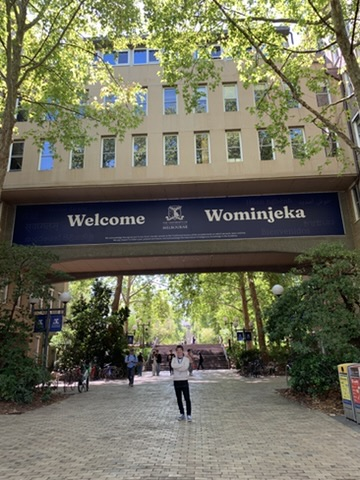
*The unmistakable "Wominjeka" welcome sign at the University of Melbourne—my academic home for the year.*

### Advancing Retinal Electrophysiology and the Exploracion2022 Project

The driving force behind this sabbatical was our ongoing work on the [**ANID Exploracion project**](/project/exploracion2022/). The project focuses on novel, complexity-based electroretinogram (ERG) analysis to identify biomarkers for neurodegenerative diseases. During my time at Unimelb, we focused heavily on extracting meaningful, entropy-based signals and complexity metrics from visual data, and implementing machine learning models to further understand the information content of these signals.

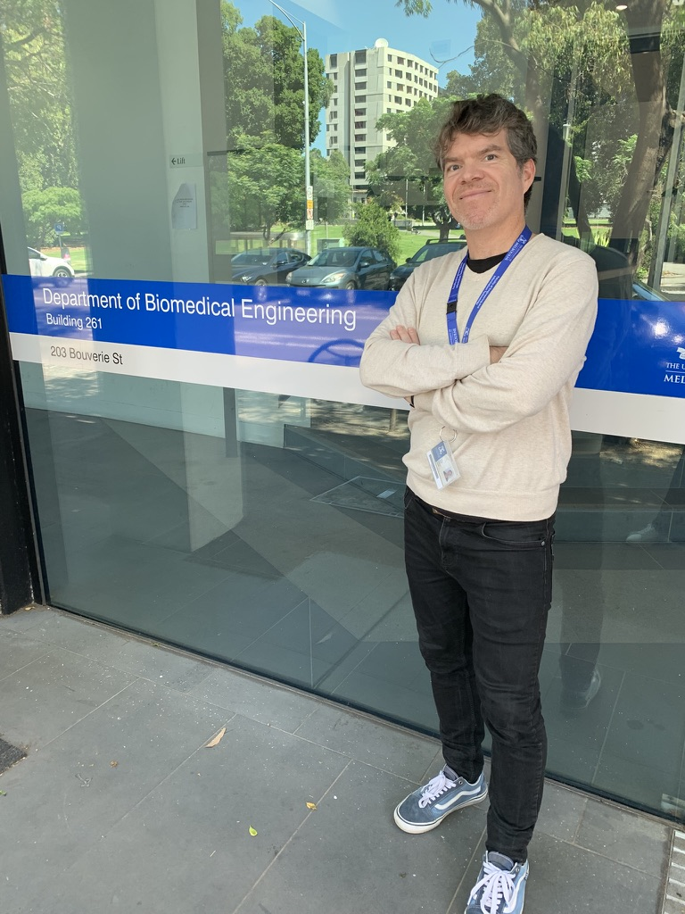
*Outside the Department of Biomedical Engineering Building 261.*

### Unforgettable Collaborations and Lab Life

I was fortunate to immerse myself in an incredible research environment and work alongside fantastic colleagues. A major highlight was collaborating with **David Grayden**, **Pip Karoly**, and the broader neuroengineering team. In Pip Karoly's lab, I expanded my focus slightly to present on **cardiac autonomic variability in Parkinson’s disease**, bridging systemic hallmarks of neurodegeneration with our core physiological focus.

Back on the retinal side, I worked closely with **Joel Villalobos** and **Joe West**. Together, we developed and refined machine learning models to analyze uERG data. This computational bridge is essential for turning theoretical complexity metrics into robust, automated diagnostic tools. 

### Seminars and Exchanging Ideas

Sharing knowledge is what makes the international scientific community thrive. In May 2025, I presented my research framework to the Department of Biomedical Engineering, exploring the fundamental question: *"What is complexity?"* and discussing how physiological time sequences encode the health of the nervous system.

The cross-disciplinary exchange continued into August 2025, where I collaborated with **Bang Bui** from the **Department of Optometry and Visual Sciences** and presented our recent progress, helping to bridge the gap between pure engineering and clinical optometry.

Beyond presenting my own work, my sabbatical was an amazing opportunity to attend cutting-edge research seminars in Melbourne. A notable highlight was an event hosted by the Aikenhead Centre for Medical Discovery (ACMD), where I attended an inspiring talk by Prof. Mark Cook on "Taking brain implants from an idea to a clinical device: Translational lessons from a founder's perspective."

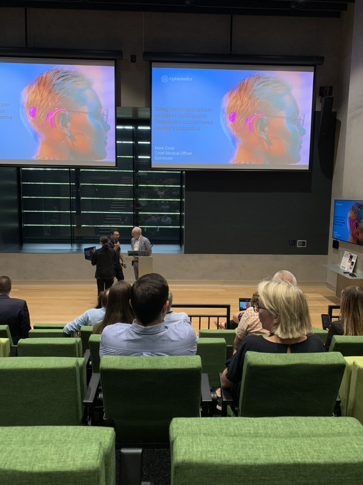
*Attending Prof. Mark Cook's presentation on translational lessons from a founder's perspective at ACMD.*

### Traveling for Science: Sydney, Auckland, and Japan

While Melbourne was an excellent base, the sabbatical offered the chance to connect with international experts and share my findings. Last February, I traveled to Sydney to attend the **Australasian Bioelectronics Neurosensing and Neuromodulation Symposium (ABNNS)** at UNSW. Keeping a pulse on the rapidly evolving field of bioelectronic medicine was incredible. 

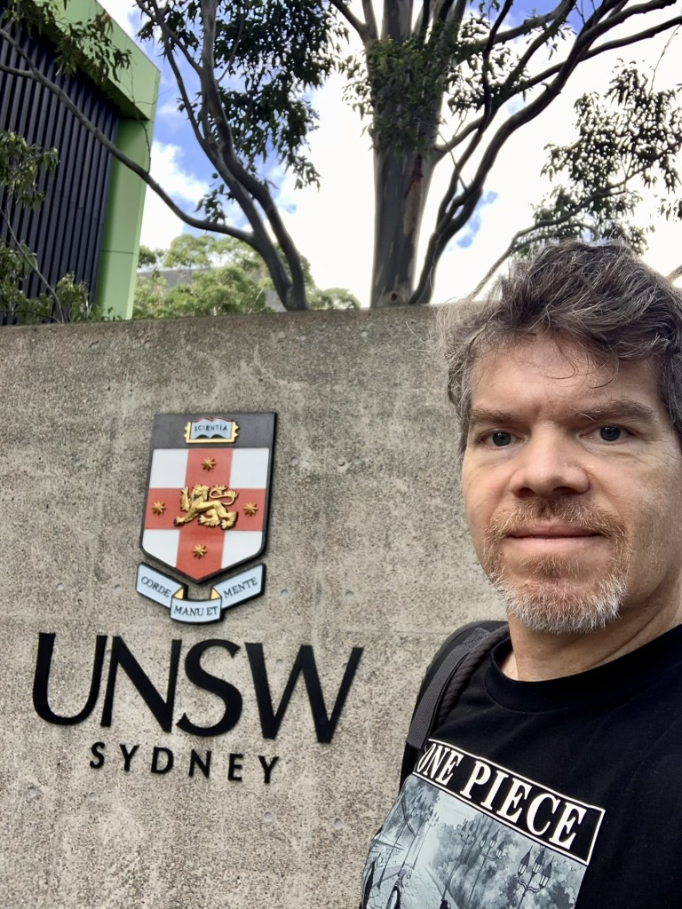
*Visiting UNSW Sydney for the Australasian Bioelectronics Neurosensing and Neuromodulation Symposium.*

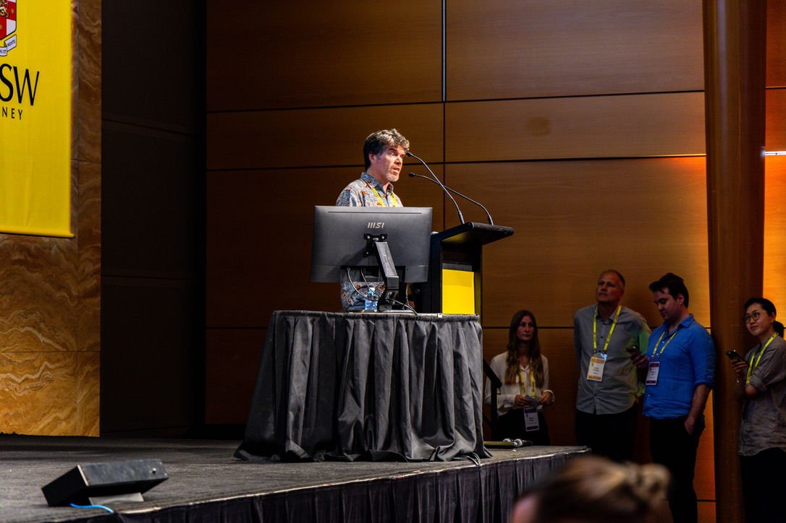
*Delivering my presentation at ABNNS.*

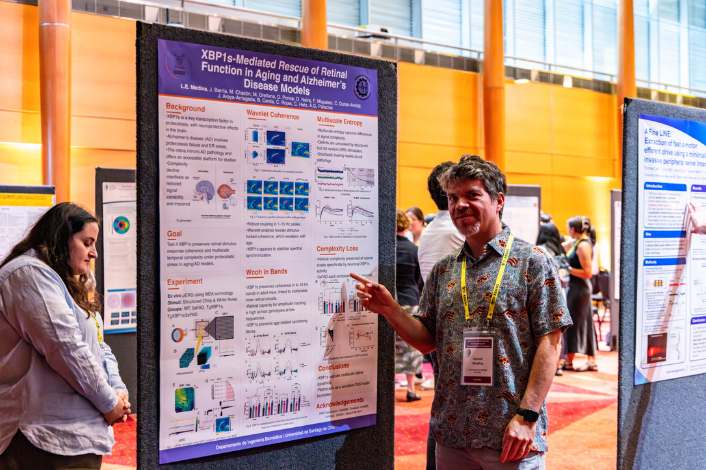
*Presenting my poster on XBP1s-mediated rescue of retinal function in aging and Alzheimer's disease models at ABNNS.*

It was a great event featuring fascinating industry talks and panel discussions on neurotechnologies.

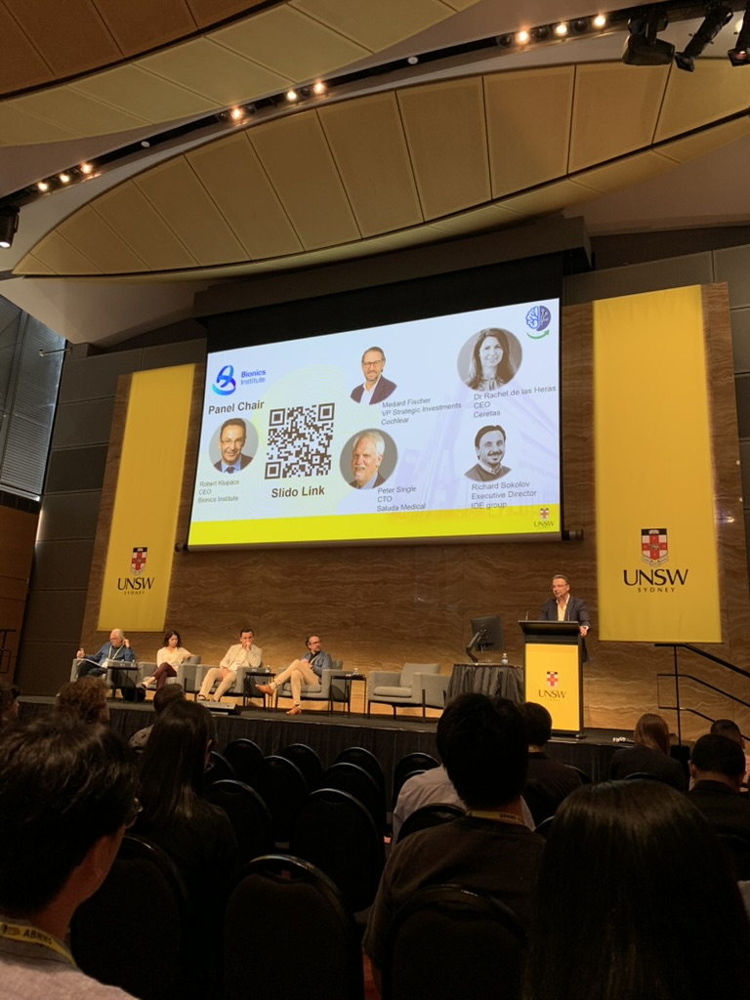
*Panel discussion at the symposium.*

I also crossed the Tasman Sea for a one-week research visit to the **School of Optometry and Vision Sciences at the University of Auckland**, New Zealand. It was fantastic to collaborate with **Monica Acosta** and her team, exploring international perspectives on retinal neurobiology. During this visit, I also had the opportunity to present my research to the department.

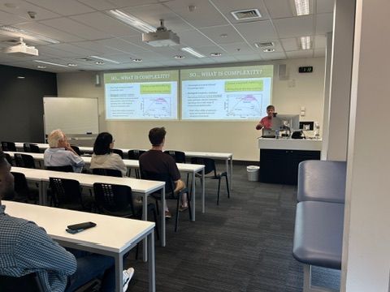
*Presenting on biological complexity and its degradation in disease at the University of Auckland.*

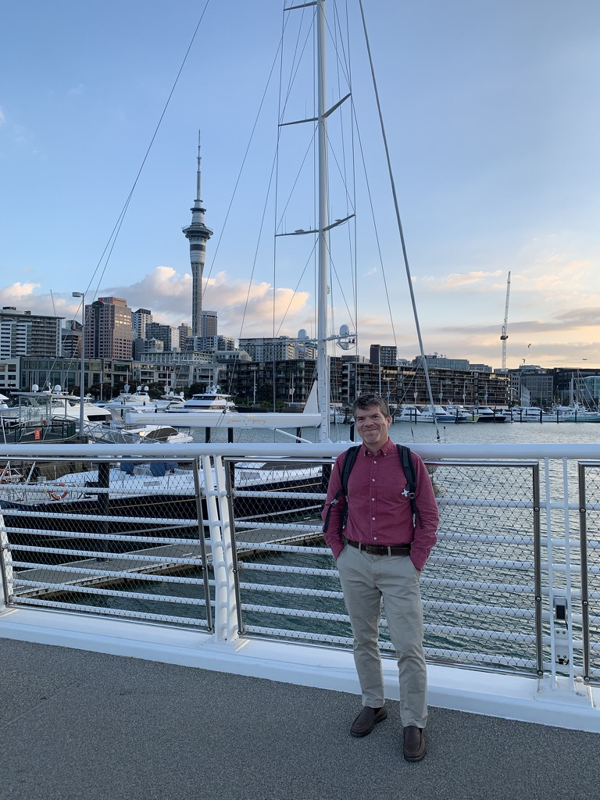
*A beautiful evening by the harbor, with the iconic Auckland Sky Tower in the background.*

My travels for collaboration didn't stop in Oceania. I also visited Japan, where I had the chance to meet my collaborator **Jose Gomez-Tames** in Tokyo. Although he is based at Chiba University, we met up to briefly discuss our ongoing collaboration on the computational modeling of spinal cord stimulation, extending our shared work into neuromodulation therapies.

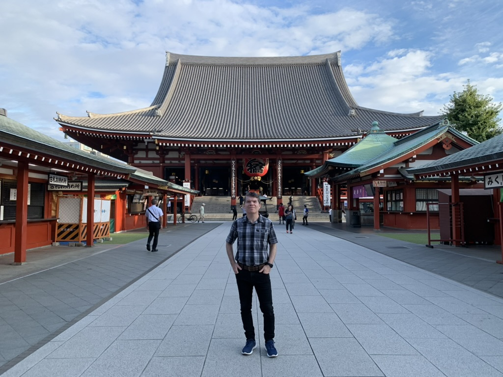
*Exploring Tokyo, Japan during my visit to meet with collaborator Jose Gomez-Tames.*

### Exploring the Non-Academic Side of Melbourne

Beyond the labs and lecture halls, Melbourne proved to be an exceptionally vibrant and livable city. I truly enjoyed immersing myself in the culture, architecture, and surrounding nature.

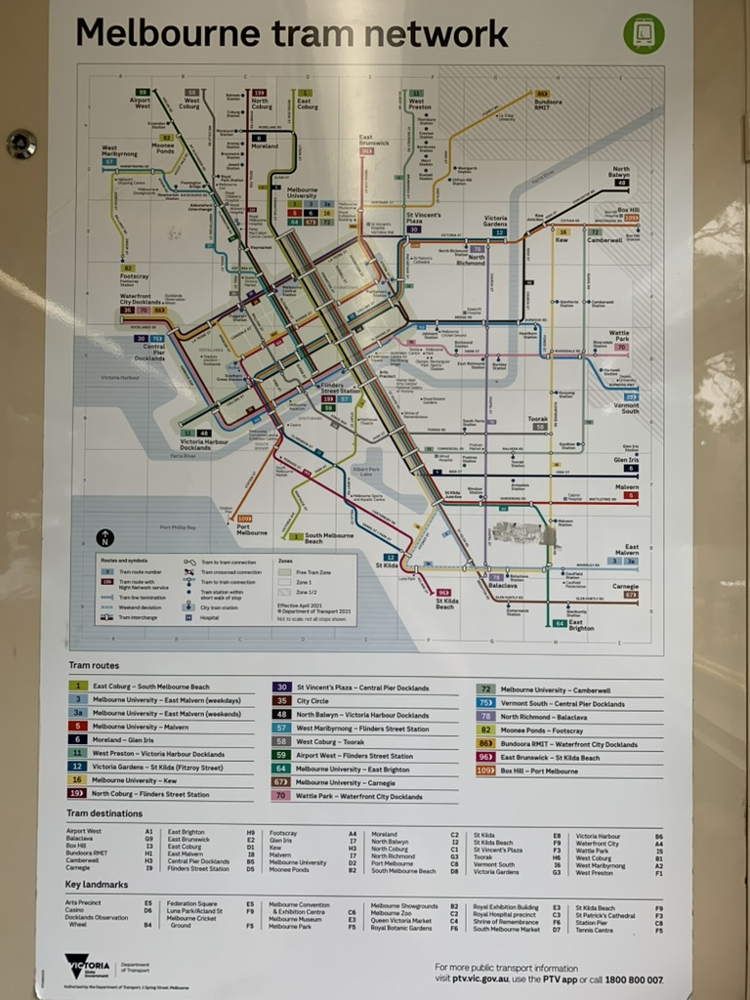
*Decoding the intricacies of the Melbourne tram network map—an absolute must for getting around town.*

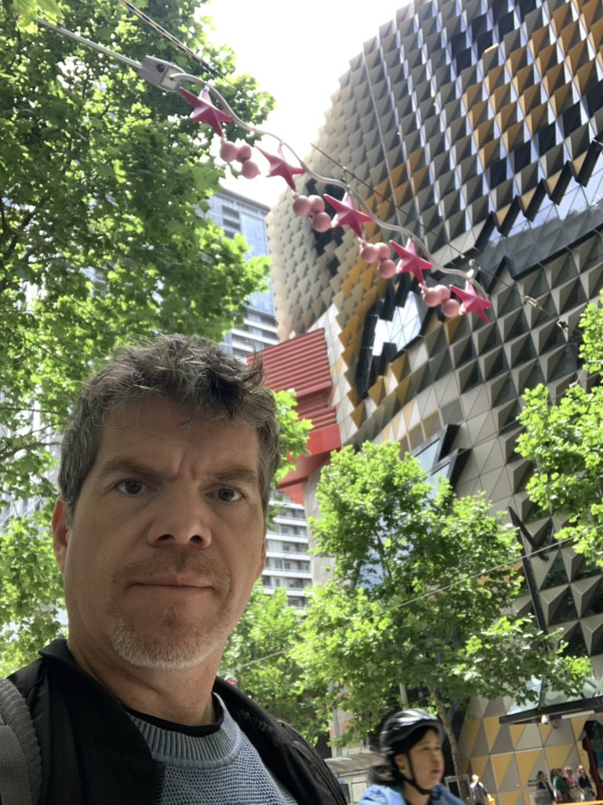
*Taking in the city’s unique architecture and vibrant streets in the Melbourne CBD near RMIT.*

Of course, no trip to Victoria is complete without hitting the road. Journeying along the Great Ocean Road and witnessing the majesty of the 12 Apostles was a breathtaking experience that I won't quickly forget.

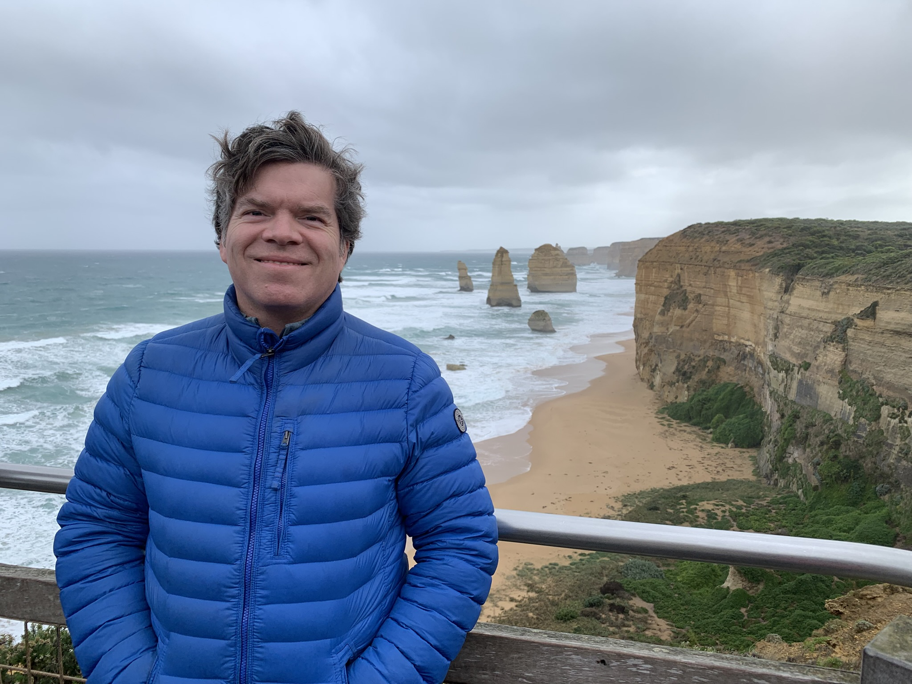
*Enjoying the wild and windy coastline at the 12 Apostles along the Great Ocean Road.*

I also had the chance to visit the beautiful Phillip Island and meet some of the local wildlife, including a friendly koala during a visit to Ballarat.

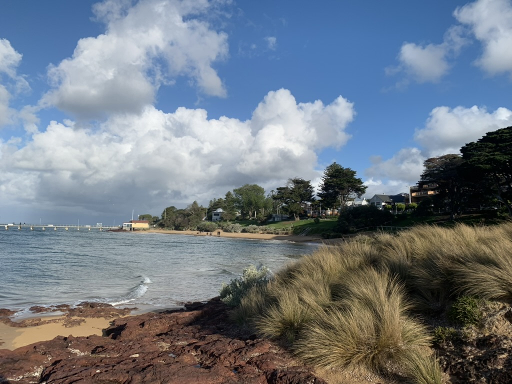
*Taking in the serene coastal views at Phillip Island.*

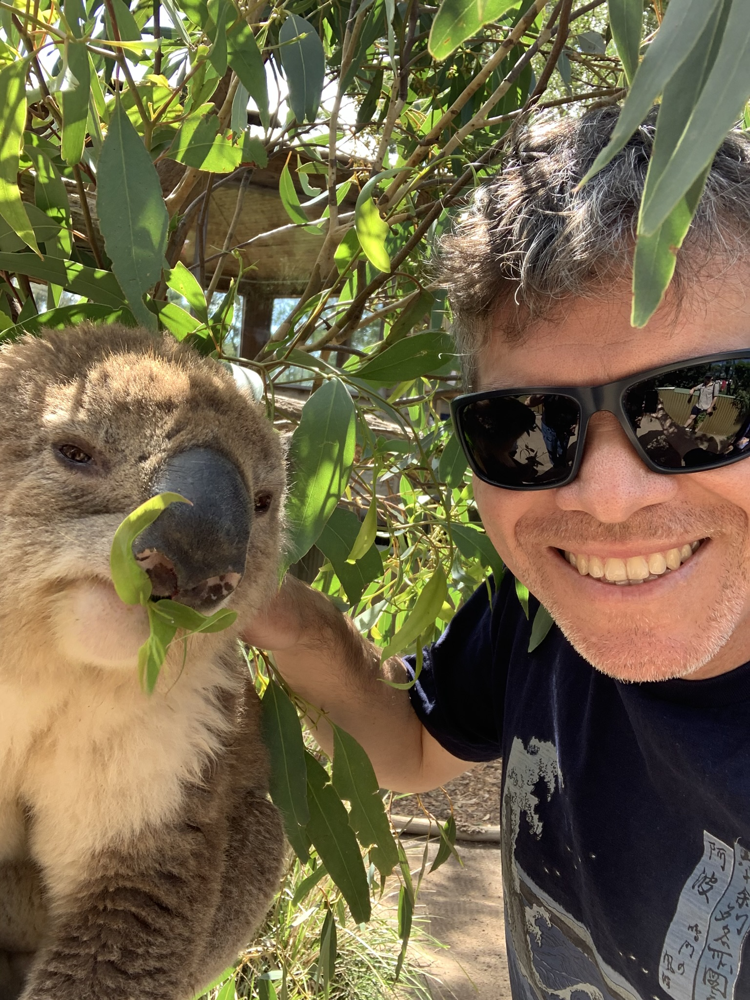
*Meeting a koala in Ballarat—a classic Australian experience!*

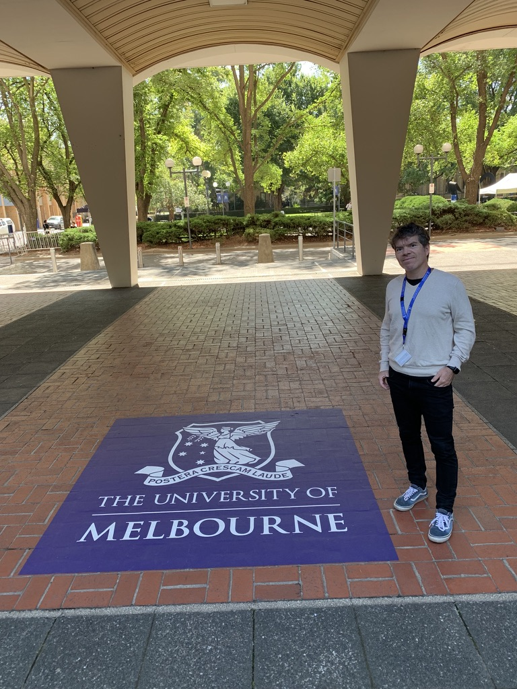
*A final snapshot at the heart of the University of Melbourne campus.*

Reflecting on this past year, I return to USACH refreshed and inspired. This sabbatical has been immensely rewarding, not just for the data gathered and models constructed, but for the friendships and collaborative bonds that will undoubtedly fuel our research in the years to come.
